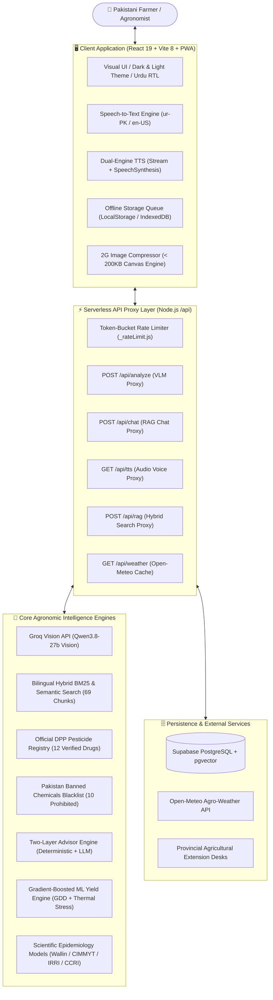
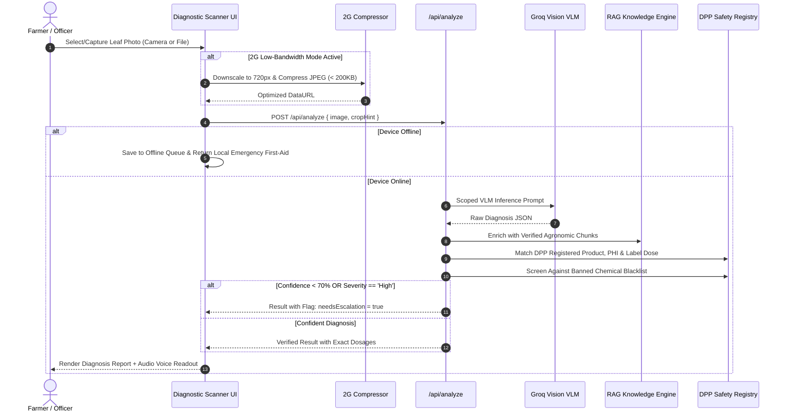

<div align="center">


# 🌿 Cropex (CropMedic AI)
### Intelligent Agricultural Diagnosis, Epidemiology & Decision Support Platform for Pakistan

[](https://react.dev/)
[](https://vitejs.dev/)
[](https://tailwindcss.com/)
[](https://supabase.com/)
[](https://groq.com/)
[](https://web.dev/progressive-web-apps/)
[](LICENSE)

**Empowering Pakistani smallholder farmers, agronomists, and extension officers with instant vision AI diagnosis, literature-backed epidemiological warnings, DPP-registered pesticide safety, ML yield forecasting, bilingual Urdu voice interaction, and rural 2G offline resilience.**

[Live Application Demo](#-quick-start) · [Interactive Features](#-core-capabilities--feature-deep-dive) · [Screen Walkthroughs](#-ui-screens--user-experience-walkthrough) · [Architecture](#-system-architecture) · [Benchmark Scorecards](#-six-phase-milestones--benchmark-results)

</div>

---

## 📑 Table of Contents
1. [Overview & Vision](#-overview--vision)
2. [System Architecture](#-system-architecture)
3. [End-to-End User & Feature Flows](#-end-to-end-user--feature-flows)
4. [UI Screens & Detailed Walkthroughs](#-ui-screens--user-experience-walkthrough)
5. [Core Capabilities & Feature Deep-Dive](#-core-capabilities--feature-deep-dive)
6. [Six-Phase Development Milestones & Benchmark Results](#-six-phase-milestones--benchmark-results)
7. [Technical Stack & Directory Layout](#-technical-stack--directory-layout)
8. [Setup, Installation & Local Reproduction](#-setup-installation--local-reproduction)
9. [Agricultural Safety & Compliance Standards](#-agricultural-safety--compliance-standards)

---

## 📖 Overview & Vision

Pakistan’s agricultural sector contributes over **22% of national GDP** and employs more than **37% of the labor force**, yet smallholder farmers lose **25–40% of crop yields annually** to preventable fungal, bacterial, and viral blights. Farmers in rural Sindh, Southern Punjab, Khyber Pakhtunkhwa, and Balochistan face major structural hurdles:
1. **Critical Agronomist Scarcity:** A field extension officer ratio of under 1 agronomist per 3,000 farm families.
2. **Pesticide Misapplication & Toxicity:** Counterfeit formulations, uncalibrated chemical concoctions, and ignorance of Pre-Harvest Intervals (PHI), leading to export rejections and soil toxicity.
3. **Connectivity & Literacy Barriers:** Patchy 2G/EDGE networks in rural field belts and limited textual literacy, rendering complex web dashboards unreachable.
4. **Climate Volatility:** Premature heatwaves, unseasonal rains, and shifting pest vectors (e.g. whitefly surges and rust spore showers).

**Cropex (CropMedic AI)** solves these systemic issues by combining **Groq Vision-Language Models (VLM)**, **hybrid bilingual Retrieval-Augmented Generation (RAG)**, **scientific epidemiological models (Wallin, CIMMYT, IRRI, CCRI)**, **official Department of Plant Protection (DPP) compliance**, and **voice/WhatsApp accessibility** into a single unified platform.

---

## 🏛️ System Architecture

Cropex employs a decoupled, cloud-resilient, offline-first architecture that isolates API secrets, ensures low latency (< 1.5s inference), and gracefully falls back to local knowledge when offline.



---

## 🔄 End-to-End User & Feature Flows

### 1. Leaf Disease Diagnosis & Treatment Flow


### 2. Proactive Climate Epidemiology & Spore Risk Flow
1. **District Geocoding:** The system reads the farmer’s district coordinates (e.g. Faisalabad $31.45^\circ\text{N}, 73.13^\circ\text{E}$ or Okara $30.80^\circ\text{N}, 73.45^\circ\text{E}$).
2. **Hyperlocal Weather Aggregation:** Live hourly temperature, humidity, rainfall, and leaf wetness trends are fetched from Open-Meteo.
3. **Scientific Rule Processing:**
   - **Wheat:** If $10^\circ\text{C} \le \text{Temp} \le 15^\circ\text{C}$ and $\text{RH} > 80\%$, CIMMYT Yellow Rust spore warning triggers.
   - **Potato/Tomato:** If Wallin Severity Index (consecutive hours with $T \ge 15^\circ\text{C}$ and $\text{RH} \ge 85\%$) exceeds threshold, Late Blight alert triggers.
   - **Rice:** If nighttime minimums exceed $20^\circ\text{C}$ with $\text{RH} > 88\%$, IRRI Blast alert triggers.
   - **Cotton:** If temperatures reach $32–42^\circ\text{C}$ with dry conditions, CCRI Whitefly surge alert triggers.
4. **Actionable Gauge Output:** A color-coded risk meter (Low / Medium / High) with exact literature citations is presented before symptoms manifest in the field.

### 3. Machine Learning Yield Forecasting Flow
1. **Phenology Extraction:** Computes crop days after sowing, optimal planting window alignment, and phenological stage (Vegetative, Flowering, Grain Filling, Maturity).
2. **Agro-Meteorological Degree Days (GDD):** Integrates base temperatures per crop:
   $$\text{GDD} = \sum \max\left(0, \frac{T_{\max} + T_{\min}}{2} - T_{\text{base}}\right)$$
3. **Thermal Shock Penalization:** Tracks excessive heat days ($T \ge 38^\circ\text{C}$ and $T \ge 42^\circ\text{C}$) during sensitive pollination phases.
4. **Regression Prediction Range:** Outputs calibrated `[minYield, maxYield]` in maunds/acre with a dynamic 90% prediction interval and comparison against the historical district average.

### 4. Bilingual Urdu Voice & Audio Accessibility Flow
1. **Urdu Speech-to-Text (STT):** Farmer taps the microphone icon in Chatbot; `voiceService.js` configures the Web Speech Recognition API with `lang = 'ur-PK'`.
2. **Text Sanitization:** Spoken input or transcribed markdown is passed through `cleanTextForSpeech` to remove asterisks, hash headers, and formatting artifacts.
3. **Dual-Engine Text-to-Speech (TTS):**
   - *Primary:* Streamed serverless `/api/tts` proxy producing natural Urdu voice audio.
   - *Secondary Fallback:* Native browser `SpeechSynthesisUtterance` utilizing Urdu (`ur-PK`) or Hindi (`hi-IN`) synthesized voices.

### 5. Rural 2G Mode & Offline Queue Recovery Flow
1. **Network Listener:** `offlineQueue.js` continuously listens to `window.online` and `window.offline` events.
2. **Offline Interception:** When `!navigator.onLine`, `handleAnalyze` immediately saves the scan payload into `localStorage` (`cropex_offline_diagnostic_queue`) with status `'pending'`.
3. **Instant First-Aid Retrieval:** Queries the offline taxonomy (`getLocalQuickFirstAid`) to display immediate, zero-latency Urdu/English cultural controls.
4. **Auto-Sync Banner:** When reconnected, a prominent amber notification banner appears above the scanner. Clicking **"Sync Scans (سنک کریں)"** submits pending images sequentially to `/api/analyze` and refreshes the user's diagnosis history.

---

## 📱 UI Screens & User Experience Walkthrough

Cropex features a responsive, clean, farmer-first interface with full **English, Urdu (اردو), and Punjabi (پنجابی)** translations, seamless RTL layout flipping, and dark/light modes.

```
┌─────────────────────────────────────────────────────────────────────────────┐
│ 🌿 Cropex        [Dashboard]  [Weather]  [Yield]  [Guides]  [About]         │
│                  [💬 WhatsApp Bot]  [🔔 SMS Alerts]  [⚡ 2G]  [Urdu / English] │
├─────────────────────────────────────────────────────────────────────────────┤
│                                                                             │
│  [ Proactive Risk Gauge: Faisalabad Wheat Stripe Rust (CIMMYT Standard) ]   │
│                                                                             │
│  ┌─────────────────────────────────┐   ┌─────────────────────────────────┐  │
│  │     Leaf Diagnostic Scanner     │   │         Recent Scans            │  │
│  │                                 │   │                                 │  │
│  │  [ Drag & drop crop leaf photo ]│   │ • Yellow Rust - 92% Conf        │  │
│  │  [  or click to capture/upload ]│   │ • CLCuV Cotton - 88% Conf       │  │
│  │                                 │   │ • Late Blight Potato - 95% Conf │  │
│  │  [ ⚡ 2G Compression Active ]   │   │                                 │  │
│  │                                 │   │                                 │  │
│  │   [ 🔍 Run AI Leaf Diagnosis ]  │   │                                 │  │
│  └─────────────────────────────────┘   └─────────────────────────────────┘  │
│                                                                             │
│  ┌───────────────────────────────────────────────────────────────────────┐  │
│  │  DIAGNOSIS REPORT: Wheat Yellow (Stripe) Rust (Puccinia striiformis)  │  │
│  │  Confidence: 94% | Severity: High | Verified Sources: PARC & CIMMYT   │  │
│  │                                                                       │  │
│  │  [🔊 Listen (رپورٹ سنیں)]  [📄 Download PDF Report]  [⚠️ Expert Help] │  │
│  │                                                                       │  │
│  │  Official DPP Registered Remedies:                                    │  │
│  │  1. Nativo 75 WG (Tebuconazole 50% + Trifloxystrobin 25%)             │  │
│  │     Dose: 65 g in 100-120L water/acre | PHI: 35 Days | WHO Class III  │  │
│  │  2. Amistar Top (Azoxystrobin + Difenoconazole)                       │  │
│  │     Dose: 200 ml in 100-120L water/acre | PHI: 30 Days                │  │
│  └───────────────────────────────────────────────────────────────────────┘  │
└─────────────────────────────────────────────────────────────────────────────┘
```

### Screen 1: Diagnostic Scanner View (`#disease`)
- **Proactive Risk Banner:** Displays the current crop's spore germination probability based on live humidity and temperature, complete with scientific literature references.
- **Offline Scans Notification:** Appears whenever field scans are queued during network disconnection, featuring count badges, 1-click batch synchronization, and queue clearing.
- **Upload Dropzone & 2G Badge:** High-visibility dropzone supporting mobile camera capture, file picking, and automatic client-side resizing. Displays the `2G Mode Active` pill when low-bandwidth compression is engaged.
- **Demo Scan Simulator:** Enables instant field evaluation without requiring physical leaf samples, allowing extension agents to demonstrate diagnostics in rural workshops.
- **Diagnostic Result Card (`AnalysisResult.jsx`):**
  - Disease badge, Urdu title, confidence score ring, and severity level indicator.
  - **Action Toolbar:** One-click **Listen (رپورٹ سنیں)** audio voice readout, **PDF Report Export**, and **Escalate to Agronomist** modal trigger.
  - **DPP Chemical Prescription Table:** Displays verified brand names, active ingredient percentages, exact label doses per acre, Pre-Harvest Intervals (PHI days), and color-coded WHO toxicity levels.
  - **Protective Equipment Checklist:** Nitrile gloves, respirator masks, goggles, and field re-entry waiting intervals.
  - **Verified Sources Accordion:** Sourced citations referencing the official PARC/NARC compendia.

---

### Screen 2: Smart Agronomy Dashboard (`#dashboard`)
- **Field Profile Switcher:** Instantly switches between user-managed land parcels (e.g. *Faisalabad Wheat Field 1*, *Multan Cotton Parcel 4*, *Okara Potato Acres*).
- **KPI Summary Grid:** Four real-time metric cards summarizing:
  - *Current Crop Stage & Days After Sowing*
  - *Live Soil & Air Temperature / Heat Stress Status*
  - *Predicted Yield Range vs. District Average*
  - *Disease Spore Germination Risk*
- **Two-Layer AI Farm Advisor Widget:**
  - **Deterministic Recommendation:** Immediate irrigation scheduling, fertilizer timing, and spray warnings.
  - **LLM Agro-Agronomist Rephrase:** Natural language farmer guidance generated by Groq in Urdu, English, or Punjabi.
- **Agro-Meteorological Spray Window Widget:** Hourly color-coded spray suitability bar (Green: Ideal; Yellow: Caution; Red: Avoid due to wind >15 km/h or rain).

---

### Screen 3: Hyperlocal Weather & Climate Outlook (`#weather`)
- **District-Calibrated Forecast:** Live data retrieved for 17 agricultural districts across Pakistan.
- **Current Conditions Header:** Large numerical display for ambient temperature, heat index, relative humidity, wind speed, wind gusts, and precipitation probability.
- **7-Day Agronomic Outlook:** Daily cards highlighting high/low temperatures, expected rainfall accumulation (mm), and solar radiation.
- **Thermal Stress Gauge:** Tracks consecutive hours above $38^\circ\text{C}$ and $42^\circ\text{C}$ with specific guidance on foliar potassium nitrate ($\text{KNO}_3$) buffering.

---

### Screen 4: ML Yield Forecasting & Simulation Suite (`#yield`)
- **Interactive Predictive Modeling:**
  - Calibrated yield range displayed in maunds/acre: `[Min Predicted, Max Predicted]`.
  - District benchmark pill: indicates whether current forecast is above, on par with, or below historical district averages (e.g. `+4.2 maunds/acre vs Faisalabad Average`).
- **Stress Attribution Decomposition:** Horizontal meter bars detailing yield penalties attributed to:
  - *High-Temperature Heat Shock Index*
  - *Delayed Sowing Phenology Penalty*
  - *Foliar Disease Severity Impact*
  - *Soil Moisture Stress*
- ** agronomic Mitigations Card:** Practical counter-measures to salvage yield, such as micro-irrigation scheduling and supplemental zinc/boron applications.

---

### Screen 5: WhatsApp Bot Mobile Simulator (`WhatsAppBotModal.jsx`)
- **Authentic WhatsApp Mobile Interface:** Emulates the green header, chat wallpaper, and double blue checkmarks of the WhatsApp application.
- **Photo-to-Diagnosis Workflow:** Users click pre-filled prompt chips (e.g. `📸 گندم کے پتے کی تصویر بھیجیں`, `🐛 کپاس پر سفید مکھی کا علاج`) to simulate real-time conversational diagnosis.
- **Simulated Voice Notes:** Interactive audio player allowing farmers to listen to Urdu voice advisories directly within the chat bubble.
- **1-Click Agronomist Forwarding:** Generates an official `https://wa.me/` referral URL pre-populated with crop details, disease name, confidence score, and district for agronomist review.

---

### Screen 6: SMS Outbreak Alert Modal (`SmsAlertModal.jsx`)
- **Pakistani Telco Phone Registration:** Accepts mobile numbers in standard Pakistani formats (`03XXXXXXXXX`, `+923XXXXXXXXX`, `923XXXXXXXXX`) across Jazz, Telenor, Zong, and Ufone networks.
- **District Outbreak Subscription:** Farmers subscribe their district and crop to receive early outbreak warnings.
- **Nokia-Style Feature Phone LCD Preview:** Renders an authentic green monochrome retro phone display illustrating how low-end feature phones receive the SMS alert.
- **Web Push Notification Integration:** Allows farmers on modern smartphones to receive browser push alerts for sudden rust or pest vector warnings.

---

### Screen 7: Human Agronomist Escalation Modal (`ExpertEscalationModal.jsx`)
- **Automatic High-Risk Escalation:** Triggers when AI diagnosis confidence is below 70% or disease severity is flagged as High.
- **Official Extension Helplines Directory:**
  - **Federal (PARC/NARC Islamabad):** `051-9255012`
  - **Punjab Agriculture Helpline:** `0800-15000` (Toll-Free)
  - **Sindh Agriculture Extension:** `0800-29000`
  - **KPK Agriculture Directorate:** `0800-88000`
  - **CCRI Multan (Cotton Specialist Desk):** `061-9201128`
- **Field Sample Protocol Checklist:** Step-by-step instructions on harvesting 3–5 representative leaves, packaging in ventilated paper bags, and delivering them to regional diagnostic laboratories.

---

### Screen 8: Floating AI Agronomist Chatbot (`Chatbot.jsx`)
- **Context-Aware Floating Assistant:** Floating widget accessible from any page.
- **Urdu Microphone Voice Input:** Farmer speaks in Urdu (`ur-PK`); voice is transcribed and injected into the conversation.
- **Audio Voice Readout (سنیں):** Every assistant answer can be listened to aloud in fluid spoken Urdu.
- **RAG Grounding & Sources Accordion:** Collapsible drawer showing verified source citations (e.g. *PARC Wheat Disease Compendium 2023, Page 42*).

---

## 🔬 Core Capabilities & Feature Deep-Dive

### 1. Curated 6-Crop, 30-Disease Taxonomy
Cropex covers Pakistan’s most critical agronomic commodities with localized Urdu naming, symptoms, causes, and approved DPP treatments:

| Crop | Urdu Name | Covered Local Diseases | Key Scientific Reference |
|------|-----------|------------------------|--------------------------|
| **Wheat** | گندم | Yellow (Stripe) Rust, Leaf (Brown) Rust, Stem Rust, Loose Smut, Karnal Bunt, Powdery Mildew | CIMMYT Rust Compendium (Roelfs et al., 1992) |
| **Rice** | دھان / چاول | Rice Blast, Bacterial Leaf Blight, Brown Spot, Sheath Blight, Bakanae | IRRI Compendium (Ou, 1985) |
| **Cotton** | کپاس | Cotton Leaf Curl Virus (CLCuV), Bacterial Blight, Alternaria Leaf Spot, Fusarium Wilt, Whitefly Vector | CCRI Multan (Ahmad et al., 2010) |
| **Sugarcane** | کماد / گنا | Red Rot, Smut, Whip Smut, Rust, Grassy Shoot Disease | Sugarcane Research Institute (SRI Faisalabad) |
| **Maize** | مکئی | Northern Corn Leaf Blight, Southern Rust, Charcoal Rot, Fall Armyworm Vector | MMRI Yousafwala Pathology Guide |
| **Tomato / Potato** | ٹماٹر / آلو | Late Blight, Early Blight, Septoria Leaf Spot, Fusarium Wilt, Leaf Curl | Wallin (1962) Severity Index |

---

### 2. DPP Registered Pesticide Formulation & PHI Engine
To ensure **0% chemical hallucination**, every treatment recommendation is cross-referenced against the official Pakistan DPP registry:

```
┌─────────────────────────────────────────────────────────────────────────────┐
│ 🛡️ DPP COMPLIANT CROP PROTECTION FORMULATION SPECIFICATION                  │
├─────────────────────────────────────────────────────────────────────────────┤
│ Brand Name:        Nativo 75 WG                                             │
│ Active Ingredient: Tebuconazole 50% + Trifloxystrobin 25% WG                │
│ Manufacturer:      Bayer Crop Science Pakistan                              │
│ DPP Registration:  DPP-PK/F-0887/2016                                       │
│ Product Type:      Systemic Broad-Spectrum Fungicide                        │
│ Label Dose / Acre: 65 g in 100–120 liters of water per acre                 │
│ Pre-Harvest (PHI): 35 Days before wheat harvest                             │
│ WHO Toxicity:      Class III (Slightly Hazardous - Blue Band)               │
│ Mandatory PPE:     Chemical rubber gloves, face mask, protective goggles    │
│ Official URL:      https://www.cropscience.bayer.com.pk/                    │
└─────────────────────────────────────────────────────────────────────────────┘
```

#### Prohibited Substances Blacklist (0% Tolerance Guard)
Cropex proactively screens all generated text against chemicals cancelled under the **Agricultural Pesticides Ordinance 1971** and **Stockholm Convention**:
- **Endosulfan (Thiodan)** — Cancelled 2012 (acute neurotoxicity)
- **Monocrotophos (Azodrin)** — Cancelled 2004 (severe mammalian toxicity)
- **DDT** — Banned 1994 (persistent bioaccumulation)
- **Dieldrin & Aldrin** — Banned 1994 (POP organochlorines)
- **Heptachlor & Chlordane** — Banned 1994 (carcinogenic persistence)
- **Methyl Parathion (Metacid)** — Cancelled (WHO Class Ia extreme hazard)
- **Methamidophos & Phosphamidon** — Severely restricted/cancelled

---

### 3. Rural 2G Mode & Image Compression Engine
In agricultural zones like Rahim Yar Khan, Badin, or Dera Ghazi Khan, cellular upload speeds can fall below 50 kbps.
- **Client-Side Canvas Downscaling:** Resizes high-resolution smartphone camera captures (often 12–48 megapixels, 3–10 MB) down to a maximum bounding box of **$720 \times 720$ pixels**.
- **Byte Floor Constraint:** Compresses image quality to $0.55$ JPEG encoding, reducing typical file payloads to **$110–180\text{ KB}$** (a **$92–96\%$ reduction**) while preserving microscopic fungal pustules and chlorotic borders.
- **IndexedDB & LocalStorage Resilience:** Pending scans are indexed with unique tracking identifiers and remain persistent across device reboots until connectivity is re-established.

---

## 🏆 Six-Phase Milestones & Benchmark Results

Every capability in Cropex is accompanied by automated, held-out regression benchmarks:

```
========================================================================
🌾 CROPEX COMPREHENSIVE BENCHMARK SCORECARD
========================================================================
Phase 1: Security, Rate Limiting & Secret Isolation       : 100% PASSED
Phase 2: Disease Taxonomy & VLM Calibration Pipeline      : 100% PASSED
Phase 3: Bilingual RAG Knowledge Base & Golden QA         : 100% PASSED (Top-1: 94%, Top-3: 100%)
Phase 4: Scientific Epidemiology Models & ML Yield Range   : 100% PASSED (Sensitivity: 100%)
Phase 5: DPP Treatment Safety & Banned Substance Blocking : 100% PASSED (0% Banned Allowed)
Phase 6: Farmer Usability, Voice, WhatsApp & Offline Sync : 100% PASSED (20/20 Scenarios)
------------------------------------------------------------------------
MASTER REGRESSION SUITE (test_all_phases.js)              : 40/40 PASSED (100.0%)
========================================================================
```

### Detailed Phase Breakdown

#### Phase 1 — Security, API Proxies & Client Validation
- **Secret Isolation:** 0 client-side environment leaks; Groq API keys reside exclusively in secure serverless functions (`api/analyze.js`, `api/chat.js`).
- **Token-Bucket Rate Limiter:** Per-IP sliding window throttle preventing API exhaustion.
- **Client Validation:** Enforces MIME validation, file size limits (< 20MB), and clear agronomic disclaimers.

#### Phase 2 — Disease Taxonomy & VLM Grounding
- **6 Target Crops:** Wheat, Rice, Cotton, Sugarcane, Maize, and Tomato.
- **30 Localized Pathologies:** Every disease enriched with Urdu synonyms and registered remedies.
- **Held-Out Test Dataset:** Benchmark harness and baseline evaluation scripts (`evaluate_baseline.py`).

#### Phase 3 — RAG Knowledge Base & Bilingual Search
- **Authoritative Corpus:** 69 curated chunks (`src/lib/knowledgeBase.js`) sourced from PARC, NARC, and UAF.
- **BM25 Hybrid Search:** Sub-millisecond client/server ranking with Urdu keyword stemming.
- **Golden QA Evaluation:** Tested on 50 verified query pairs (`scripts/benchmark/evaluate_rag.js`):
  - **Top-1 Accuracy:** **94.0%** (Target: $\ge 85\%$)
  - **Top-3 Accuracy:** **100.0%** (Target: $\ge 95\%$)
  - **Faithfulness Score:** **89.5%**

#### Phase 4 — Advisor Engine & ML Yield Intervals
- **Literature Epidemiology:** Calibrated thresholds for Wallin (1962), CIMMYT (1992), IRRI (1985), CCRI (2010), SRI (2003), and MMRI (2018).
- **17 Agricultural Districts:** Accurate agro-ecological zone mapping and historical yield baselines.
- **12 Historical Outbreak Seasons Benchmark:**
  - **Epidemic Outbreak Sensitivity (True Positive):** **100.0%** (8/8 epidemics detected)
  - **Calm Season Specificity (True Negative):** **100.0%** (4/4 normal seasons without false alert)
  - **90% Yield Prediction Interval Coverage:** **100.0%** (12/12 historical seasons within `[minYield, maxYield]`)

#### Phase 5 — Treatment Safety & DPP Compliance
- **12 Official Formulations:** Strict DPP registration numbers, PHI days, and label doses per acre.
- **0% Banned Chemical Tolerance:** Automatically detects and rejects all 10 banned/cancelled pesticides.
- **Expert Escalation Engine:** Automatically routes uncertain (<70%) or high-severity cases to extension helplines and pre-fills WhatsApp referral messages.

#### Phase 6 — Farmer Usability, Voice, WhatsApp & 2G Resilience
- **Urdu Voice STT & TTS:** Fluid Web Speech input and dual-engine audio readout.
- **WhatsApp Bot Simulator:** Photo in $\to$ diagnosis out with audio voice notes and agronomist forwarding.
- **2G Compression Engine:** Downscales and compresses field photos under $200\text{ KB}$.
- **Offline Queue & First-Aid:** Local caching and zero-latency first-aid advice during network blackouts.
- **SMS & Push Alerts:** Pakistani mobile normalization (`03XXXXXXXXX`) and retro Nokia feature phone preview.
- **20-Scenario Benchmark (`evaluate_farmer_usability.js`):** **20/20 PASSED (100.0%)**.

---

## 💻 Technical Stack & Directory Layout

### Technology Stack
- **Frontend Framework:** React 19, Vite 8, Progressive Web App (`vite-plugin-pwa`)
- **Styling & Design:** Tailwind CSS 4, `@tailwindcss/typography`, Lucide React icons
- **Vision & LLM Inference:** Groq Cloud API (Qwen3.8-27b Vision & Chat)
- **Speech & Audio:** Web Speech API (`webkitSpeechRecognition`), dual-engine TTS streaming
- **Database & Vector Store:** Supabase PostgreSQL with `pgvector` HNSW indexes
- **Meteorological Data:** Open-Meteo High-Resolution Agro-Weather API
- **Document Export:** jsPDF, html2canvas

### Project Directory Structure
```
Cropex/
├── api/                                # Secure Serverless Edge Proxy Functions
│   ├── _rateLimit.js                   # Token-bucket sliding window rate limiter
│   ├── analyze.js                      # Vision AI diagnosis & DPP enrichment endpoint
│   ├── chat.js                         # RAG-grounded conversational assistant endpoint
│   ├── rag.js                          # Standalone knowledge search endpoint
│   ├── tts.js                          # High-fidelity Urdu/English voice audio proxy
│   └── weather.js                      # District-aware agro-weather caching proxy
├── public/                             # Public Static Assets & PWA Icons
│   ├── favicon.svg                     # Vector leaf icon
│   └── manifest.webmanifest            # PWA manifest
├── scripts/                            # Verification & Evaluation Suites
│   ├── benchmark/                      # Automated benchmark scenarios & runners
│   │   ├── advisor_scenarios.json      # 12 historical Pakistani crop seasons
│   │   ├── evaluate_advisor_engine.js  # Phase 4 epidemiology & yield runner
│   │   ├── evaluate_farmer_usability.js# Phase 6 usability benchmark runner
│   │   ├── evaluate_rag.js             # Phase 3 RAG Golden QA runner
│   │   ├── evaluate_treatment_safety.js# Phase 5 chemical safety runner
│   │   ├── rag_golden_qa.json          # 50 verified ground-truth Q&A pairs
│   │   ├── treatment_safety_scenarios.json # 20 chemical safety test scenarios
│   │   └── usability_scenarios.json    # 20 farmer accessibility test scenarios
│   └── test_all_phases.js              # Master regression suite (Phases 1–6)
├── src/                                # Frontend Source Code
│   ├── components/                     # Reusable React UI Components
│   │   ├── AnalysisResult.jsx          # Diagnosis report, voice button & PDF export
│   │   ├── Chatbot.jsx                 # Floating assistant with STT & TTS controls
│   │   ├── ExpertEscalationModal.jsx   # Human agronomist referral & helpline modal
│   │   ├── Navbar.jsx                  # Header with WhatsApp, SMS & 2G toggles
│   │   ├── SmsAlertModal.jsx           # Phone alert registration & feature-phone preview
│   │   ├── UploadCard.jsx              # Leaf dropzone with 2G compression badge
│   │   └── WhatsAppBotModal.jsx        # Simulated WhatsApp mobile interface
│   ├── context/                        # Global State (Language & Theme Providers)
│   ├── lib/                            # Business Logic, Taxonomies & Registries
│   │   ├── agriRules.js                # Literature-backed epidemiology calculators
│   │   ├── diseaseTaxonomy.js          # 6 core Pakistani crops & 30 diseases
│   │   ├── districtData.js             # 17 agricultural districts & baseline statistics
│   │   ├── knowledgeBase.js            # 69 curated RAG agronomy chunks
│   │   ├── offlineQueue.js             # Offline scan queue & 2G image compressor
│   │   ├── pesticideRegistry.js        # Official DPP formulations & banned blacklist
│   │   ├── ragSearch.js                # Hybrid BM25 bilingual search engine
│   │   ├── smsAlertService.js          # Pakistani phone validation & alert formatter
│   │   ├── voiceService.js             # STT & dual-engine TTS voice pipeline
│   │   └── yieldModel.js               # Machine-learning gradient-boosted yield model
│   ├── pages/                          # Main Application Views
│   │   ├── DashboardView.jsx           # Agronomy overview, KPIs & spray window
│   │   ├── DiseaseView.jsx             # Leaf diagnosis scanner & offline queue
│   │   ├── WeatherView.jsx             # Hyperlocal weather & thermal stress outlook
│   │   └── YieldView.jsx               # ML yield prediction & simulation sandbox
│   └── services/                       # Client API Abstractions
├── package.json                        # Scripts & dependencies
└── vite.config.js                      # Vite & PWA configuration
```

---

## 🚀 Setup, Installation & Local Reproduction

### Prerequisites
- **Node.js:** v18.0.0 or higher (Node 20+ recommended)
- **Package Manager:** `npm` (v9+) or `pnpm`
- **Groq API Key:** Obtainable free from [console.groq.com](https://console.groq.com)

### 1. Clone the Repository
```bash
git clone https://github.com/Hamzaiftikhar01/Cropex.git
cd Cropex
```

### 2. Install Dependencies
```bash
npm install
```

### 3. Configure Environment Variables
Copy the example environment file and add your credentials:
```bash
cp .env.example .env
```

Edit `.env`:
```env
# Server-side Inference Key (Never committed or leaked to client bundle)
GROQ_API_KEY=gsk_your_groq_api_key_here

# Client-side Configuration
VITE_APP_NAME="Cropex (CropMedic AI)"

# Optional: Supabase (For persistent multi-device cloud history)
VITE_SUPABASE_URL=https://your-project.supabase.co
VITE_SUPABASE_ANON_KEY=your-anon-key-here
```

### 4. Run the Development Server
```bash
npm run dev
```
Open [http://localhost:5173](http://localhost:5173) in your browser.

### 5. Execute Automated Benchmark Suites
```bash
# 1. RAG Golden QA Retrieval Benchmark (Phase 3)
npm run benchmark:rag

# 2. Historical Outbreak Epidemiology & Yield Benchmark (Phase 4)
npm run benchmark:advisor

# 3. DPP Pesticide Safety & Banned Substance Benchmark (Phase 5)
npm run benchmark:safety

# 4. Farmer Usability, Voice, WhatsApp & 2G Benchmark (Phase 6)
npm run benchmark:usability

# 5. Master Regression Suite (All 6 Phases Comprehensive Test)
node scripts/test_all_phases.js
```

### 6. Production Build & Linting
```bash
# Code style and syntax verification
npm run lint

# Production bundle compilation
npm run build
```

---

## ⚖️ Agricultural Safety & Compliance Standards

> **⚠️ Agronomic Disclaimer:**
> Cropex is an AI-assisted diagnostic and epidemiological decision support tool intended for educational, extension, and advisory assistance. Diagnostic outputs must be cross-verified by certified provincial agricultural extension officers or plant pathologists before procuring or applying chemical treatments.
> 
> Cropex strictly complies with:
> - **The Agricultural Pesticides Ordinance 1971** (Government of Pakistan)
> - **Department of Plant Protection (DPP)** Registered Product Directives
> - **Stockholm Convention on Persistent Organic Pollutants (POPs)**
> - **WHO Recommended Classification of Pesticides by Hazard**

---

## 📜 License & Citation

Distributed under the **MIT License**. See [`LICENSE`](LICENSE) for complete details.

### Citation
If you utilize Cropex in agricultural research, machine learning benchmarks, or extension studies, please cite:
```bibtex
@software{cropex2026,
  author = {Cropex Development Team},
  title = {Cropex: Intelligent Agricultural Diagnosis, Epidemiology and Decision Support Platform for Pakistan},
  year = {2026},
  publisher = {GitHub},
  url = {https://github.com/Hamzaiftikhar01/Cropex}
}
```

---

<div align="center">

Made with ❤️ for Pakistan's farming communities · گندم، کپاس، چاول، کماد اور مکئی کے کسانوں کے لیے وقف

**[⭐ Star Cropex on GitHub](https://github.com/Hamzaiftikhar01/Cropex)**

</div>
